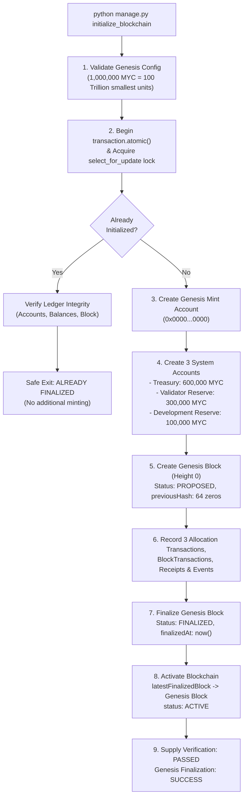
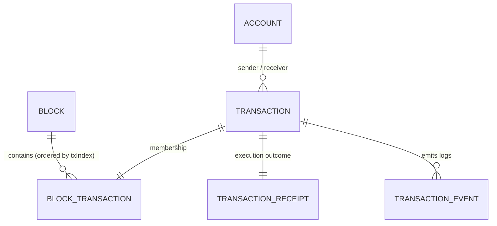

# Blockchain Genesis Initialization & Initial Supply Guide

This document explains the **Genesis Block initialization** and **Initial Coin Supply distribution** implemented in the `mycoin` project. It describes what happens under the hood when executing `python manage.py initialize_blockchain`, how the database records are structured, and the cryptographic and architectural principles enforced.

---

## 1. High-Level Overview

In an account-based cryptocurrency (similar to Ethereum), the blockchain ledger starts at **Height 0** with a unique block called the **Genesis Block**. 

At genesis:
1. The **initial coin supply** ($1,000,000 \text{ MYC}$) is created (minted) out of the protocol genesis origin.
2. The supply is distributed into **three system reserve accounts** (Treasury, Validator Reserve, and Development Reserve).
3. Every coin allocation is recorded as an auditable **Transaction**, **BlockTransaction**, **TransactionReceipt**, and **TransactionEvent**.
4. Cryptographic roots (**Merkle Root**, **State Root**, and **Block Hash**) are computed deterministically.
5. The Genesis Block is permanently **Finalized** and locked against modification or deletion.
6. The `Blockchain` record is marked `ACTIVE` and its `latestFinalizedBlock` is pointed to the Genesis Block.



---

## 2. Core Concepts & Design Principles

### A. Zero Floating-Point Arithmetic (Smallest Units)
In monetary and blockchain applications, using floating-point types (`float` or `double`) leads to rounding errors and non-deterministic behavior. 

* The `Blockchain` uses `decimals = 8`.
* **$1 \text{ MYC} = 10^8 = 100,000,000 \text{ smallest units}$**.
* All database fields storing monetary amounts use `BigIntegerField` via `amount_field()`.

| Allocation | Token Amount | Smallest Units Formula | Stored Value in Database |
| :--- | :--- | :--- | :--- |
| **Total Initial Supply** | $1,000,000 \text{ MYC}$ | $1,000,000 \times 10^8$ | `100,000,000,000,000` ($100 \text{ Trillion}$) |
| **Treasury Allocation** | $600,000 \text{ MYC}$ | $600,000 \times 10^8$ | `60,000,000,000,000` ($60 \text{ Trillion}$) |
| **Validator Reserve** | $300,000 \text{ MYC}$ | $300,000 \times 10^8$ | `30,000,000,000,000` ($30 \text{ Trillion}$) |
| **Development Reserve** | $100,000 \text{ MYC}$ | $100,000 \times 10^8$ | `10,000,000,000,000` ($10 \text{ Trillion}$) |

The sum of all allocations ($600\text{k} + 300\text{k} + 100\text{k} = 1,000,000 \text{ MYC}$) is validated before any database changes are made.

---

### B. Deterministic System Accounts

System accounts represent protocol reserves, not ordinary users.

1. **No User or Wallet Associated (`wallet = None`)**:
   System accounts are governed by blockchain protocol rules, not private keys or external wallets.
2. **Account Type**:
   Configured as `accountType = "CONTRACT"` (non-EOA), satisfying the constraint:
   `check(Q(accountType="EOA") | Q(wallet__isnull=True))`
3. **Deterministic Addresses**:
   To guarantee idempotency, each system account has a fixed, unique 42-character address (`0x` + 40 lowercase hexadecimal characters):
   * **Genesis Mint / Zero Address**: `0x0000000000000000000000000000000000000000`
   * **Treasury**: `0x0000000000000000000000000000000000000001`
   * **Validator Reserve**: `0x0000000000000000000000000000000000000002`
   * **Development Reserve**: `0x0000000000000000000000000000000000000003`

---

### C. Full Audit Trail: How the Initial Supply is Recorded

Rather than silently updating account balances with no ledger record, every single coin allocation is recorded on-chain using 4 interconnected models:



1. **`Transaction`**:
   * Type: `TRANSFER`
   * Sender: Genesis Mint Account (`0x0000...0000`)
   * Receiver: The respective system account (`TREASURY`, `VALIDATOR_RESERVE`, `DEVELOPMENT_RESERVE`)
   * Nonce: Sequential (`0`, `1`, `2`)
   * Gas Price: `0`
   * Fee Paid: `0`
   * Status: `FINALIZED`
2. **`BlockTransaction`**:
   * Links each transaction to the Genesis Block at `txIndex = 0, 1, 2`.
   * Serves as the authoritative source of truth for transaction order within the block.
3. **`TransactionReceipt`**:
   * Records execution outcome (`status = SUCCESS`, `resultCode = "GENESIS_ALLOCATION"`, `gasUsed = 0`).
4. **`TransactionEvent`**:
   * Emits structured JSON event logs (`eventType = "TRANSFER"`, `allocationType`, `amount`, `isGenesis: true`) for block explorers and indexing services.

---

### D. Cryptographic Roots & Hashes

The Genesis Block header stores cryptographic commitments:

1. **`previousHash`**:
   Set strictly to 64 zeros (`GENESIS_PREVIOUS_HASH = "0" * 64`), as the genesis block has no predecessor.
2. **`merkleRoot`**:
   Computed using a binary SHA-256 Merkle tree over the three allocation transaction hashes ($T_0, T_1, T_2$):
   $$\text{MerkleRoot} = \text{SHA256}(\text{SHA256}(H(T_0) + H(T_1)) + \text{SHA256}(H(T_2) + H(T_2)))$$
3. **`stateRoot`**:
   Computed as the SHA-256 hash of all account balances sorted by address:
   $$\text{StateRoot} = \text{SHA256}(\text{"0x0...0:0,0x0...1:60000000000000,..."})$$
4. **`blockHash`**:
   Canonical SHA-256 hash of the block header:
   $$\text{BlockHash} = \text{SHA256}(\text{chainId} : \text{height} : \text{previousHash} : \text{merkleRoot} : \text{stateRoot} : \text{timestamp})$$

---

### E. Two-Stage Finalization & Immutability

The `Block` and `BlockTransaction` models enforce strict immutability checks in `save()` and `delete()`:
* `BlockTransaction.save()` raises `ImmutableRecordError` if `block.status == "FINALIZED"`.
* `Block.save()` and `Block.delete()` raise `ImmutableRecordError` once a block is finalized.

To satisfy these constraints:
1. The block is first created and saved with `status = "PROPOSED"`.
2. All `Transaction`, `BlockTransaction`, `TransactionReceipt`, and `TransactionEvent` records are saved.
3. The block status is transitioned to `FINALIZED` with `finalizedAt = timezone.now()`.
4. From this point forward, the genesis block and its transactions can never be modified or deleted.

---

### F. Idempotency & Concurrency Safety

The management command is **100% idempotent**:
* All operations run inside `transaction.atomic()`.
* Row-level locking (`select_for_update()`) prevents concurrent workers from creating duplicate genesis data.
* **If run a second time**:
  1. The service detects the existing Genesis Block at height 0.
  2. It verifies that all 3 system accounts exist with the exact expected allocations.
  3. It verifies that `Blockchain.latestFinalizedBlock` references the Genesis Block.
  4. It returns `already_initialized = True` and exits cleanly.
  5. **No duplicate accounts, blocks, transactions, or minting will ever occur.**
* **If corrupted data is detected** (e.g. tampered balance or invalid hash), it raises `GenesisInitializationError` and halts safely rather than silently overwriting data.

---

## 3. How to Run & Verify

### Command Execution
```bash
python manage.py initialize_blockchain
```

### Expected Output
```text
Blockchain initialized successfully.

Chain: MYCOIN
Chain ID: 1001
Genesis Block: 0
Initial Supply: 1,000,000 MYC

System Accounts:
- Treasury: 600,000 MYC (0x0000000000000000000000000000000000000001)
- Validator Reserve: 300,000 MYC (0x0000000000000000000000000000000000000002)
- Development Reserve: 100,000 MYC (0x0000000000000000000000000000000000000003)

Supply Verification: PASSED
Genesis Finalization: SUCCESS
```

### Re-running the Command (Idempotent Check)
```bash
python manage.py initialize_blockchain
```
```text
Blockchain is already initialized and verified.

Chain: MYCOIN
Chain ID: 1001
Genesis Block: 0
Initial Supply: 1,000,000 MYC

System Accounts:
- Treasury: 600,000 MYC (0x0000000000000000000000000000000000000001)
- Validator Reserve: 300,000 MYC (0x0000000000000000000000000000000000000002)
- Development Reserve: 100,000 MYC (0x0000000000000000000000000000000000000003)

Supply Verification: PASSED
Genesis Finalization: ALREADY FINALIZED
```

---

## 4. Code Structure & Key Files

| File | Purpose |
| :--- | :--- |
| [`network/services/genesis.py`](file:///c:/Users/lenovo/OneDrive/Desktop/workspace_govinda/mycoin/network/services/genesis.py) | Pure domain service for genesis configuration, hashing algorithms, system account generation, transaction auditing, and state verification. |
| [`network/management/commands/initialize_blockchain.py`](file:///c:/Users/lenovo/OneDrive/Desktop/workspace_govinda/mycoin/network/management/commands/initialize_blockchain.py) | Django management command providing CLI arguments, formatted styling, and error handling. |
| [`network/tests.py`](file:///c:/Users/lenovo/OneDrive/Desktop/workspace_govinda/mycoin/network/tests.py) | Unit test suite covering all 13 verification cases including idempotency, atomicity, immutability, and failure rollback. |
| [`wallets/models.py`](file:///c:/Users/lenovo/OneDrive/Desktop/workspace_govinda/mycoin/wallets/models.py) | Defines `Account`, `SystemAccountType`, and wallet constraints. |
| [`ledger/models.py`](file:///c:/Users/lenovo/OneDrive/Desktop/workspace_govinda/mycoin/ledger/models.py) | Defines `Block`, `Transaction`, `BlockTransaction`, `TransactionReceipt`, and `TransactionEvent`. |
| [`common/models.py`](file:///c:/Users/lenovo/OneDrive/Desktop/workspace_govinda/mycoin/common/models.py) | Defines `GENESIS_PREVIOUS_HASH`, `ImmutableRecordError`, and validators. |

